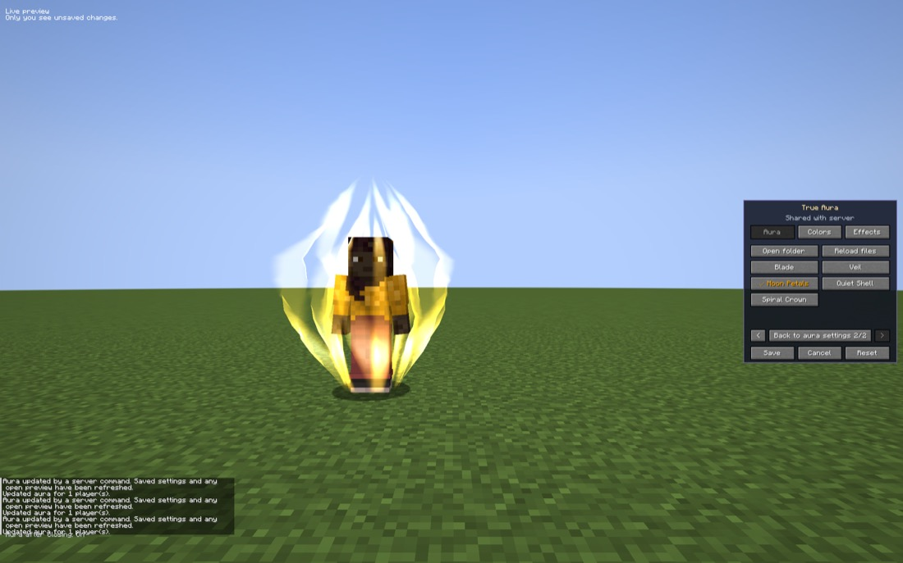

# สร้างและนำเข้ารูปแบบออร่าของตัวเอง — True Aura 0.9

ใช้กับ Minecraft Java 1.20.1 / Forge และ True Aura 0.9 ขึ้นไป รูปแบบนี้เป็นไฟล์ **JSON** ที่บอกทรงและการเคลื่อนไหวของผิวออร่า ไม่ต้องคอมไพล์ Java ใหม่ สี ความเข้ม ขนาด และเอฟเฟกต์เปิด–ปิดยังปรับจากหน้า O ได้ตามเดิม

## นำเข้าในเกม

1. เข้าโลก กด **O → ลักษณะ → รูปแบบ → เปิดโฟลเดอร์**
2. วางไฟล์ `.json` ใน `config/trueaura/auras/` ของอินสแตนซ์ที่กำลังเล่น เมื่อเปิดครั้งแรก มอดจะสร้างตัวอย่าง 3 ไฟล์ให้
3. กด **โหลดไฟล์ใหม่** แล้วใช้ `<` / `>` เปลี่ยนหน้ารายการ ชื่อจากไฟล์อยู่ต่อจากรูปแบบเดิม 10 แบบ
4. เลือกรูปแบบเพื่อดูตัวอย่าง แล้วกด **บันทึก** เพื่อใช้จริงและแชร์ให้คนอื่น ยกเลิก/Esc ทิ้งค่าที่ยังไม่บันทึก
5. ถ้าแก้ไฟล์ของแบบที่กำลังเลือก กดโหลดใหม่อีกครั้ง ตัวอย่างจะเปลี่ยนตาม แล้วกดบันทึกเพื่อเผยแพร่การแก้ไข

เมื่อพบไฟล์ผิด รูปแบบที่ถูกต้องยังโหลดได้ วางเมาส์เหนือปุ่มโหลดใหม่เพื่อดูรายงาน หรืออ่านในแชตหลังโหลดใหม่ (แสดงรายละเอียดสูงสุด 8 รายการ) ตรวจชื่อไฟล์ สะกดฟิลด์ และเครื่องหมาย comma ให้ครบ

ข้อมูลรูปแบบที่กดบันทึกจะฝังใน `config/trueaura-client.toml` ด้วย การย้าย/ลบไฟล์ต้นฉบับจึงไม่ทำให้แบบที่บันทึกหาย และยังปรากฏในรายการให้เลือก ถ้าต้องการกลับแบบเดิมให้เลือกชื่อรูปแบบในเกมหรือกด Reset



## เริ่มจากไฟล์ตัวอย่าง

คัดลอก [moon_petals.json](../examples/auras/moon_petals.json) แล้วเปลี่ยน `id` และ `name` ของตัวเอง หรือสร้าง `my_aura.json` ดังนี้:

```json
{
  "version": 1,
  "id": "my_pack:blue_flame",
  "name": "My Blue Flame",
  "pattern": "flame",
  "layers": [
    {
      "height": 1.5,
      "offset": 0,
      "profile": [[0, 0.35], [0.35, 0.75], [0.7, 0.55], [1, 0.08]],
      "amplitude": 0.12,
      "waves": 6,
      "speed": 3,
      "twist": 0.3,
      "role": 0
    }
  ]
}
```

ชื่อ Blue Flame ไม่เปลี่ยนสีโดยอัตโนมัติ ให้เลือกสีฟ้าใน O → สี ตัวอย่างนี้กำหนดเฉพาะรูปทรง

## อ่านรูปทรงจาก profile

ออร่าแต่ละชั้นเป็นผิวรอบตัวละคร คล้ายการหมุนเส้นด้านข้างรอบแกนตั้ง แต่ละคู่คือ `[ระดับความสูง, รัศมี]`:

- ระดับ `0` คือฐานของชั้น และ `1` คือยอดของชั้น
- รัศมีเป็นบล็อกก่อนคูณขนาดในหน้า O เช่น `0.75` คือกว้างจากแกนกลางออกไป 0.75 บล็อก
- `[[0, 0.35], [0.5, 0.9], [1, 0.1]]` ให้ฐานแคบ กลางป่อง และยอดแหลม
- จุดต้องเรียงระดับจากน้อยไปมาก ห้ามซ้ำ เริ่มที่ 0 และจบที่ 1 มอดเชื่อมจุดด้วยเส้นตรงและเก็บสันเหล่านี้ไว้เมื่อวาดระยะไกล
- `height: 1.5` หมายถึงสูง 1.5 เท่าของความสูงตัวละคร ไม่ใช่ 1.5 บล็อก
- `offset` ยกฐานของชั้นขึ้นจากเท้า หน่วยเป็นบล็อกก่อนคูณขนาด

ใช้ 2–4 ชั้นซ้อนกันได้ เช่นชั้นนอกกว้าง + เส้นชั้นใน + พลังบริเวณเท้า ลองเปลี่ยนทีละค่า กดโหลดใหม่ แล้วดูตัวอย่างก่อนบันทึก

## ฟิลด์และขอบเขต

| ฟิลด์ | ความหมาย | ค่า/ขอบเขต |
| --- | --- | --- |
| `version` | รุ่นรูปแบบไฟล์ ต้องระบุ | `1` |
| `id` | รหัสไม่ซ้ำ ต้องระบุ | `namespace:name`, a–z, 0–9, `_`, `-`; รวมไม่เกิน 96 ตัว |
| `name` | ชื่อที่เห็นในรายการ ต้องระบุ | 1–128 ไบต์ UTF-8 ใช้ภาษาไทยได้ ห้ามรหัสควบคุม/จัดรูปแบบ |
| `pattern` | ลวดลาย shader ต้องระบุ | `flame`, `flow`, `spikes`, `vortex`, `lightning`, `pulse`, `inferno`, `lotus`, `blade`, `veil` |
| `layers` | ผิวออร่าแต่ละชั้น ต้องระบุ | 1–4 ชั้น |
| `profile` | จุดระดับ/รัศมีของชั้น ต้องระบุ | 2–12 จุด ระดับ 0–1, รัศมี 0–2 |
| `height` | ความสูงเทียบตัวละคร | 0.1–3; ค่าเริ่มต้น 1.4 |
| `offset` | ยกฐานของชั้น | 0–2; ค่าเริ่มต้น 0 |
| `amplitude` | ระยะที่คลื่นขยับผิวเข้า–ออก | 0–0.5; ค่าเริ่มต้น 0.08 |
| `waves` | จำนวนคลื่นรอบตัว | จำนวนเต็ม 1–16; ค่าเริ่มต้น 5 |
| `speed` | ความเร็วคลื่น; ค่าลบกลับทิศ | −8 ถึง 8; ค่าเริ่มต้น 3 |
| `twist` | จำนวนรอบที่บิดจากฐานถึงยอด | −3 ถึง 3; ค่าเริ่มต้น 0 |
| `role` | ชั้นลวดลายของ shader เดิม | 0 ผิวหลัก, 1 ริ้วพลัง, 2 พลังฐาน; ค่าเริ่มต้น 0 |

`pattern` และ `role` ทำงานร่วมกัน ลวดลายบางแบบมีการตัดผิวโปร่งใส/ไหลขึ้น จึงไม่จำเป็นต้องเห็นผิวทั้งแผ่นตาม profile สีฐาน/ประกายใช้จากค่าของผู้เล่น

รับ JSON UTF-8 ไม่เกิน **8 KiB ต่อไฟล์** และไม่เกิน **128 ไฟล์** ต่อโฟลเดอร์ นับขนาดหลังเติมค่าเริ่มต้นด้วย ไม่รับคอมเมนต์ ฟิลด์ไม่รู้จัก คีย์ซ้ำ ตัวเลข NaN/Infinity หรือ symbolic link รหัส `id` ซ้ำจะรับเฉพาะไฟล์แรกตามลำดับชื่อไฟล์ ไม่ค้นในโฟลเดอร์ย่อย

ไฟล์ JSON นี้ไม่รันสคริปต์ ไม่โหลด URL และไม่ใช่ไฟล์โมเดล `.bbmodel` / `.obj` หรือ shader `.fsh` หากต้องการโมเดลประเภทนั้นต้องเขียนตัวเรนเดอร์เพิ่มในซอร์ส ไม่ใช่เปลี่ยนนามสกุลไฟล์

## เล่นหลายคนและคำสั่ง

ติดตั้ง **True Aura รุ่นเดียวกันทั้งเซิร์ฟเวอร์และผู้เล่นที่มีมอด** (รุ่นปัจจุบัน 0.10 ใช้ protocol 6) เมื่อบันทึก มอดส่งข้อมูลรูปทรงที่ตรวจแล้วไปให้ผู้ชมอัตโนมัติ ผู้ชมไม่ต้องมีไฟล์ JSON; เซิร์ฟเวอร์ยังจำกัดขนาดและความเข้มตามคอนฟิคเดิม

คำสั่งแก้สี/ขนาด/ความเข้มและ R เปิด–ปิดยังรักษารูปแบบนำเข้าไว้ `set shape` จะกลับเป็นรูปทรงมาตรฐาน:

```mcfunction
/aura set intensity 3
/aura set shape flame
/aura set copy_shape Steve
/aura player Alex set copy_shape Steve
```

`copy_shape` คัดลอกเฉพาะรูปทรงของผู้เล่นออนไลน์ รวมข้อมูลแบบนำเข้า แต่ไม่เปลี่ยนสีหรือความเข้มของเป้าหมาย บรรทัดแก้ผู้อื่นต้องมี OP ระดับ 2 เช่นเดิม ผู้เล่นธรรมดาคัดลอกรูปทรงมาใช้กับตัวเองได้

ถ้าเซิร์ฟเวอร์ไม่มีมอด จะเห็นเฉพาะออร่าของตัวเอง การเห็นรูปแบบที่ผู้อื่นแชร์ไม่ได้ติดตั้งไฟล์นั้นในโฟลเดอร์ของคุณ; ใช้คำสั่งคัดลอก หรือขอไฟล์ต้นฉบับจากผู้สร้างถ้าต้องการแก้ต่อ

## โค้ดที่ควรเริ่มอ่าน

- [CustomAura.java](../src/main/java/dev/trueaura/aura/CustomAura.java): schema, ค่าที่อนุญาต, ตัวอ่าน/เขียน JSON
- [CustomAuraMesh.java](../src/main/java/dev/trueaura/client/CustomAuraMesh.java): สร้างจุดผิวและคลื่น
- [CustomAuraLibrary.java](../src/main/java/dev/trueaura/client/CustomAuraLibrary.java): โหลดไฟล์และรายงานข้อผิดพลาด
- [AuraSettingsScreen.java](../src/main/java/dev/trueaura/client/AuraSettingsScreen.java): รายการนำเข้าและตัวอย่างก่อนบันทึก
- [AuraPacketCodec.java](../src/main/java/dev/trueaura/network/AuraPacketCodec.java): ส่งข้อมูลรูปแบบแบบมีขอบเขต

Build ด้วย JDK 17: `./gradlew test build` แล้วใช้ JAR จาก `build/libs/` ดูการตั้งค่าเซิร์ฟเวอร์และ shader ใน [README](../README.md)
