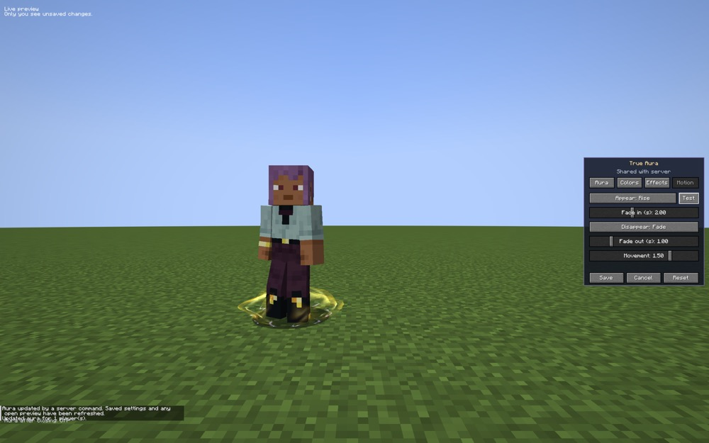
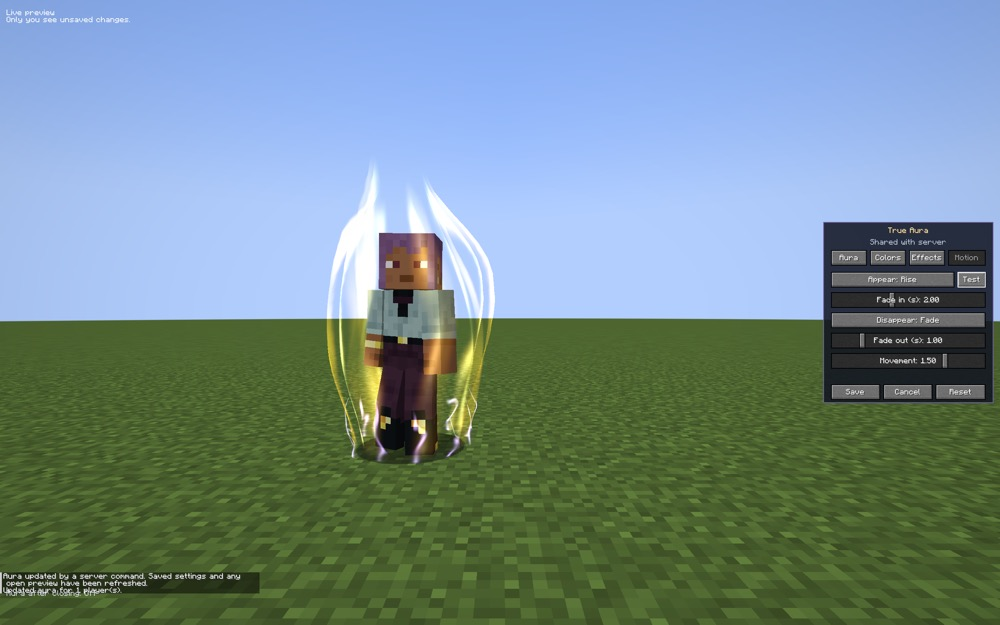

# True Aura 0.10.0 verification — 2026-11-20

## Automated checks

- Java 17, Forge 47.4.23 / Minecraft 1.20.1, macOS Apple Silicon.
- Full `test --rerun build`: **73 tests passed**, no failures/errors/skips.
- Standalone `./gradlew -p tools --offline test --rerun`: **66 tests passed**.
- Local Forge builds used cached dependencies with `--offline -Dnet.minecraftforge.gradle.check.certs=false` because this environment's preliminary libraries.minecraft.net certificate probe fails. No downloads were performed with certificate validation disabled. GitHub CI retains normal TLS validation.
- Coverage includes instant first-frame appearance/disappearance, independent durations, interrupted transitions, animation bounds and preservation through ordinary setting edits, packet round trips, preview isolation, spring settling, yaw wrapping, teleport reset, read-only interpolation, foot anchoring and disabling motion.
- Rise geometry tests check zero/full-height endpoints, angular seam closure, staggered flame tips and anchored feet. Full progress preserves the original mesh exactly.
- A read-only review found that jump deformation could invert very short imported profiles. A regression failed before the fix; height-relative compression/stretch bounds now keep the vertical mapping monotonic. The regression passes. The subsequent Rise addition was checked through its tests and runtime screenshots, without a second independent review.
- Release archive: version 0.10.0, 98 matching Thai/English translation keys, no development smoke-test classes or nested third-party JARs.

## Actual in-game test

The opt-in `tools/motion-test/java/dev/trueaura/client/MotionSmokeTest.java` runs in an isolated copied flat world with Epic Fight 20.14.17. It uses actual screen clicks, movement/jump key states, commands and Minecraft screenshots. It is excluded from the production JAR.

Verified Motion tab controls, local replay while the real aura remained off, Save, instant appearance/disappearance, configured two-second Rise, walking, turning, jumping, settling after stopping, imported geometry and setting movement strength to zero. The completed test exited normally. Screenshots show the aura starting around the feet, reaching waist height, then fully surrounding the player.

Evidence: `run-motion-test/screenshots/aura-motion-*.png`, local log `/tmp/trueaura-010-final-runtime.log` containing `AURA_MOTION_TEST COMPLETE`. The walking spring energy was 0.426 and dropped below 0.05 after stopping. Turning and jumping produced nonzero twist and vertical response.

An earlier harness attempt sent too many setup commands at once and Minecraft disconnected the test player for chat spam. Setup now sends one settings update, with later commands spaced apart; the successful run includes this correction.

## Dedicated server and two real clients

A dedicated server bound to 127.0.0.1 and two independent clients, AuraDev and AuraViewer, connected with Epic Fight installed. AuraDev set instant appearance, gradual disappearance over two seconds and movement strength 1.8, then walked. AuraViewer received all those settings and its remote spring responded to AuraDev's movement (energy 0.176). Its Minecraft screenshot visibly shows the remote imported cyan aura.

Evidence: `/tmp/trueaura-010-viewer.log` contains `AURA_MOTION_TEST REMOTE VERIFIED`; screenshot `run-import-viewer/screenshots/aura-motion-remote-moving.png`. The server saved and stopped normally, then only those isolated clients were closed. This checks animation settings and remote movement; the Rise progression was visually checked in the single-player run above.

## Scope

This is bounded visual spring deformation, not cloth collision or gameplay physics. Observers compute movement from replicated entity positions, so timing may vary with network latency. Motion strength zero restores the original deformation-free geometry. Rise also applies to imported JSON surfaces; closing gradually retracts toward the feet when Rise is selected.

The existing shader compatibility render path is unchanged. This release is not a new multi-pack shader benchmark; see [0.8 shader verification](verification-0.8.md). Multiplayer requires protocol 6 / True Aura 0.10 on all modded peers.

Release JAR SHA-256: `f9361ad945a027aae73f6117a7a5b85bceb713409c444f8673925273fd84c869`.
