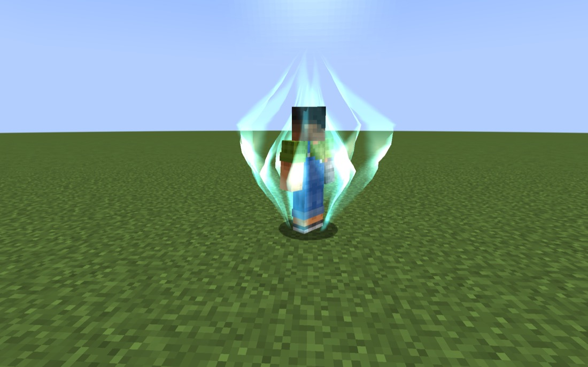

# True Aura 0.9.0 verification — 2026-11-18

## Automated checks

- Java 17, Forge 47.4.23 / Minecraft 1.20.1, macOS Apple Silicon.
- Full `test --rerun build`: **60 tests passed**, 0 failures/errors/skips.
- Standalone `./gradlew -p tools --offline test`: **53 tests passed**.
- The local Forge build used cached dependencies with `--offline -Dnet.minecraftforge.gradle.check.certs=false` because the preliminary libraries.minecraft.net certificate probe failed in this environment. No downloads were performed with certificate validation disabled. The normal documented build and GitHub CI retain TLS validation.
- New tests cover strict/oversized/deep JSON, finite bounded parameters, immutable definitions, malformed/duplicate/symlink imports, reload, bundled examples, definition preservation through appearance edits, protocol round-trips, mesh seams/animation and narrow profile crests at both LODs. Command parsing includes copy_shape under the existing permission tree.
- A read-only reviewer found a valid narrow-profile regression: uniform vertical samples omitted thin crests. A new test failed before the fix. The renderer now includes every profile breakpoint in the bounded grid; the regression passes. Maximum near tessellation is 32 sides × 26 vertical intervals × 4 layers (13,312 vertices); distant 16 × 18 × 4 (4,608 vertices).
- Release archive: version 0.9.0, three JSON examples, matching Thai/English translation keys, no dev smoke-test classes or nested third-party jars.

## In-game import flow

The opt-in `tools/import-test/java/dev/trueaura/client/ImportSmokeTest.java` runs in an isolated copied flat world with Epic Fight 20.14.17. It actually clicks the shape picker, next page, imported entry, Reload and Save, and captures Minecraft screenshots.

Verified: imported Moon Petals visible in preview; Save persists the definition; editing its JSON changes the reloaded draft; a deliberately invalid adjacent file gives one visible error while three valid files load; color/intensity commands preserve the definition; off removes the aura; choosing a built-in via command clears the definition. The temporary malformed file was removed and the example restored. The successful run exited normally.

An initial test-harness error tried to call mouseReleased through mc.screen after Save closed the screen. The harness was fixed to retain the clicked Screen reference; this was not a production mod crash. Screenshots were recaptured in the successful run.

Evidence: `run-import-test/screenshots/aura-import-{picker,preview,reload,saved,off}.png`, local log `/tmp/trueaura-090-runtime-final.log` with `AURA_IMPORT_TEST COMPLETE`. The final parser-only wording change turns Gson's setLenient suggestion into “Invalid JSON syntax”; the final build includes it.

## Dedicated server and two real clients

A separate dedicated server bound to 127.0.0.1 and two independent offline development clients (AuraDev / AuraViewer) connected successfully. The owner selected a custom definition and enabled it. The viewer's client cache received `example:moon_petals` with two layers and enabled state, and its Screenshot API capture visibly shows the owner's cyan custom aura. At that time, the viewer's `config/trueaura/auras` directory did not exist.

Console `/aura player AuraViewer set copy_shape AuraDev` succeeded. Server status reported the custom ID while preserving the viewer's original colors/intensity/off state. The viewer's client TOML contained the embedded definition afterward, still with no local imports folder. Server was stopped normally and only the isolated test clients were closed.

This is not a new three-pack shader benchmark: the previously validated 0.8 compatibility path is reused for custom geometry. See [shader verification](verification-0.8.md). Fullscreen bloom/reflection integration and generic model/GLSL imports remain out of scope.

## Public source

Source, Gradle wrapper, CI, example JSON, Thai/English authoring guides and development harness source are published. Local worlds, runtime logs/configs, caches, credentials and third-party jars are excluded. Releases carry the reobfuscated JAR and its SHA-256 checksum separately.
